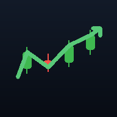

# 📈 Trading Journal

A private, **offline-first trading journal** you can install on your iPhone Home Screen like a native app. Log trades, see a **calendar P&L**, and get a full set of stats and analytics. No account, no server — **all your data stays on your device** in the browser's local storage.



## Features

- **📅 Calendar P&L** — month grid with each day coloured green/red by net P&L, trade counts, weekly totals and a monthly summary.
- **📊 Dashboard** — net P&L, win rate, profit factor, expectancy, average win/loss (payoff), max drawdown, streaks, and an **equity curve** + daily P&L chart.
- **📈 Analytics** — P&L broken down by **symbol**, **strategy**, and **day of week**, a P&L distribution histogram, best/worst trades, and a full metrics table.
- **✍️ Trade log** — add/edit/delete trades with side, quantity, entry/exit (auto-calculates P&L) **or** manual P&L, fees, R‑multiple, strategy, tags and notes. Search and filter by result.
- **💾 Your data** — one‑tap **CSV** and **JSON** export/import (backups), currency + starting‑balance settings, and sample data to explore.
- **📲 Installable PWA** — works fully offline once added to your Home Screen.

## Backtest a strategy (Python)

The [`backtest/`](backtest/) folder has a Python template. Plug your entry, exit and stop rules into `backtest/my_strategy.py`, run `python backtest/run_backtest.py`, and get a full performance report. It also writes a `journal_import.csv` you can load into this app with **Import CSV**. See [backtest/README.md](backtest/README.md).

## Add to your iPhone Home Screen

1. Open the site in **Safari** (see *Hosting* below for the URL).
2. Tap the **Share** button (the square with an up arrow).
3. Scroll down and tap **“Add to Home Screen.”**
4. Tap **Add.** Launch it from the new icon — it opens full‑screen and works offline.

> On Android/Chrome, use the **⋮ menu → Install app / Add to Home screen**.

## Hosting (free, HTTPS)

A PWA needs to be served over HTTPS. This repo includes a GitHub Pages workflow that does it for you:

1. Push this repo to GitHub (branch `main`).
2. In the repo, go to **Settings → Pages → Build and deployment → Source → GitHub Actions**.
3. The included workflow (`.github/workflows/deploy-pages.yml`) deploys automatically on every push.
4. Your app will be live at `https://<your-username>.github.io/<repo-name>/`.

Because every path is relative, it works from that sub‑folder URL with no changes.

### Run locally

Any static file server works, e.g.:

```bash
python3 -m http.server 8000
# then open http://localhost:8000
```

Opening `index.html` directly via `file://` mostly works, but the service worker (offline caching) only registers over `http(s)://`.

## Project structure

```
index.html              App shell (views + modals)
css/styles.css          Dark, mobile-first styling
js/storage.js           localStorage persistence, formatting, date helpers
js/calc.js              Trade math, stats & aggregations
js/charts.js            Dependency-free canvas charts
js/app.js               UI controller (views, calendar, modals, import/export)
manifest.webmanifest    PWA manifest
sw.js                   Service worker (offline cache)
icons/                  App icons (generated)
scripts/gen-icons.js    Regenerate icons: `node scripts/gen-icons.js`
```

## Privacy

Everything is stored locally in your browser via `localStorage`. Nothing is uploaded anywhere. **Export a JSON backup regularly** — clearing Safari's website data (or deleting the app) will remove your trades.

## CSV import format

Header row with any of these columns (order-independent): `date, symbol, side, qty, entry, exit, fees, pnl, r, strategy, tags, notes`. Dates accept `YYYY-MM-DD` or `M/D/YYYY`. Tags are separated by `;` or `,`. If `pnl` is provided it's used directly; otherwise it's computed from entry/exit/qty/side/fees.
